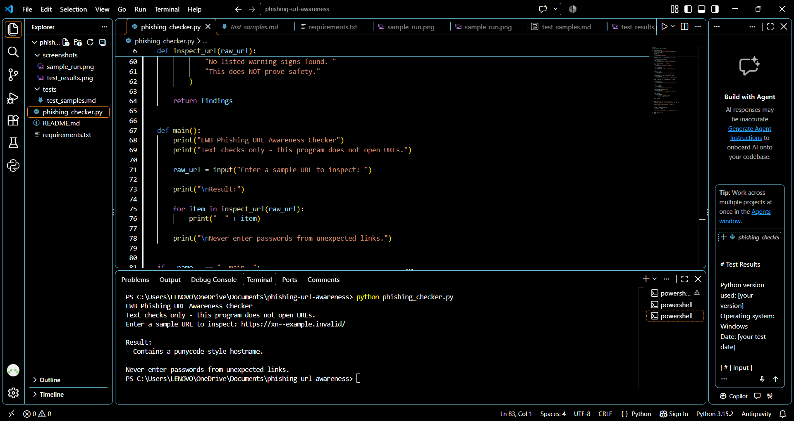
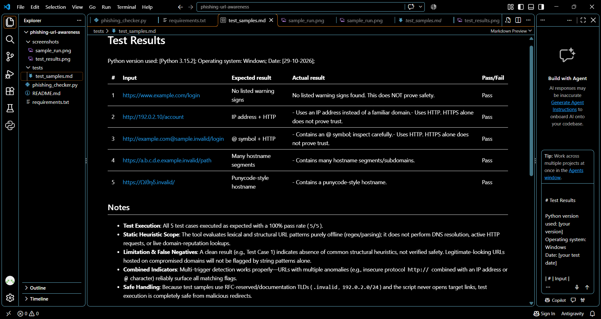

# EWB Phishing URL Awareness Checker

## Overview
This project is a Python-based educational tool that checks
URL text for selected phishing warning signs.

## Features
- Detects the @ symbol
- Flags URLs longer than 100 characters
- Identifies IP-address hostnames
- Flags hostnames with five or more segments
- Detects punycode-style hostnames
- Flags HTTP URLs
- Check multiple URLs
- Display a warning summary

## Requirements
- Python 3.10 or later
- No additional packages required

## How to Run
Open a terminal in the project folder and run:

python phishing_checker.py

## Example Output
- Uses an IP address instead of a familiar domain.
- Uses HTTP. HTTPS alone does not prove trust.

REVIEW CAREFULLY: 2 warning sign(s) found.

Never enter passwords from unexpected links.
## Testing
See tests/test_samples.md for the five test cases
and their actual results.

## Screenshots

## Improvements
1. Multiple URL checking: Allows users to check several URLs in one session and quit by typing q.
2.Warning summary: Displays the number of detected warning signs and asks users to review the URL carefully

## Limitations
This is an educational tool that reads URL text only.
It does not visit websites, scan for malware, or prove
that a URL is safe. No warning signs found does NOT
mean a URL is safe.

## Ethical Use
Use the provided sample strings. Do not collect credentials
or test websites without permission.

## Author
RONGALI DEVENDRA
Batch : Cybersecurtiy Internship | Batch 1
Course : EWB Courses--AI-Powered Cybersecurity

